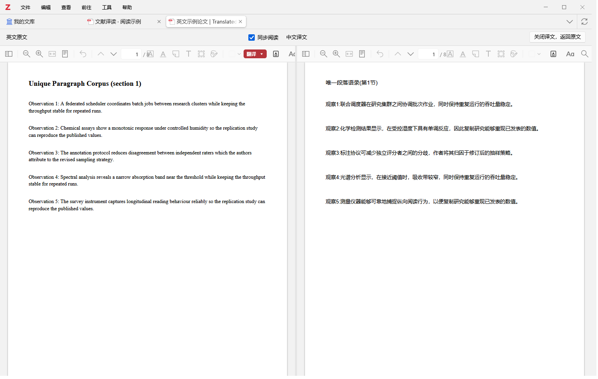

# Wenxian Yidu · 文献译读

[简体中文](README.md) | [English](README.en.md)

Translate research papers inside Zotero: read PDFs side by side, compare paragraphs, translate a selection, or type your own text.

**[Download](https://github.com/JackBlack419/wenxian-yidu/releases/latest) · [Interactive English guide](https://jackblack419.github.io/wenxian-yidu/?lang=en) · [Chinese illustrated manual](docs/user-guide.md)**

For **Windows x64 and Zotero 10**, with text-based PDFs. Free and open source under AGPL-3.0. The base XPI is about 5.2 MB; full-document components and optional offline models download separately.

## Your first translation

1. Download the `.xpi` asset from [Releases](https://github.com/JackBlack419/wenxian-yidu/releases/latest). Source code archives are for developers, not plugin installation.
2. In Zotero, open **Tools → Plugins → gear icon → Install Plugin From File**, select the XPI, then restart Zotero.
3. Open a PDF and click **Translate (翻译) ▾**. On first use, settings opens so you can choose an engine and confirm **Use current engine (使用当前引擎)**. Keyless Bing web translation is available to try; you can also configure your own API.
4. Return to the paper and choose a mode.

| Task | Mode | What happens |
| --- | --- | --- |
| Read the full paper | **Split / 分屏翻译** | Original PDF on the left, translation on the right. Resize panes and scroll together or independently. |
| Read paragraph by paragraph | **Paragraph comparison / 对照翻译** | Chinese appears beneath English in a reflowed view. Read completed paragraphs as others load. |
| Understand a word or sentence | **Selection / 划词翻译** | Select text and see its translation in the sidebar, in original, split or paragraph views. |
| Translate your own text | **Input / 输入翻译** | Type or paste, translate and copy the result. No selected library item is required. |

Original PDFs and annotations are preserved. Generated translated PDFs are separate attachments. Both split and paragraph views offer **Close translation, return to original (关闭译文，返回原文)**.

Screenshots use the Chinese interface; the [bilingual HTML guide](https://jackblack419.github.io/wenxian-yidu/?lang=en) explains the matching controls in English.

## Optional features and limits

- **Offline English → Simplified Chinese:** click Prepare offline translation in settings, wait for download, verification and a successful test, then select MTranServer. Windows x64 CPU only; no system Node, Python or Docker installation needed. Prepare full-document components before going offline too.
- **Recovery:** failed full-document paragraphs get one automatic retry with the same engine. Retry remaining failures manually; successful paragraphs and checkpoints are retained.
- **Cache:** identical configuration, languages and normalized text can be reused across views. Different paragraph extraction may miss the cache; finished PDFs cannot be directly converted into paragraph views.
- **Guide downloads:** Releases includes a self-contained HTML and a website ZIP. Open locally or upload the extracted website to your static host. The same bilingual guide is on GitHub Pages.
- Scanned PDFs/OCR, other operating systems and live progressive split-PDF rendering are not included. Check complex layouts and formulas against the original.

Free web services may throttle or stop working. The plugin is free; your API provider may charge. Online text goes to the engine you select. The plugin never silently switches providers after failure; offline failure never forwards text online. Check terminology, negation, numbers and formulas carefully.

## Development and feedback

Use Node.js 24 and npm: `npm ci`, `npm run typecheck`, `npm run test:unit`, then `npm run build`. See [development](docs/development.md), [verification](docs/verification.md), [limits](docs/known-limitations.md) and [contribution guidance](CONTRIBUTING.md).

[Report issues](https://github.com/JackBlack419/wenxian-yidu/issues) with versions, reproduction steps and redacted screenshots. Never include API keys, private papers or a real Zotero profile.

Based on [Z-Transplit](https://github.com/Liozhang/z-transplit), with engine-adapter references from [Translate for Zotero](https://github.com/windingwind/zotero-pdf-translate). Attribution, pinned commits and licenses are retained in [UPSTREAM.md](UPSTREAM.md), [third-party notices](docs/third-party.md) and [LICENSE](LICENSE).
