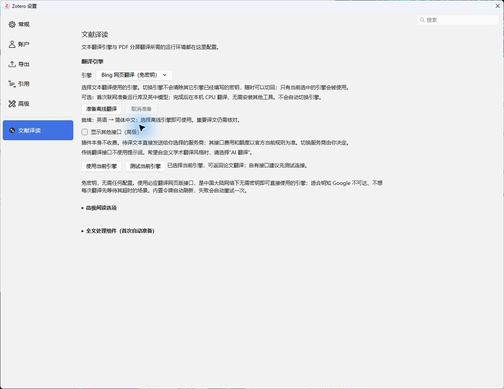
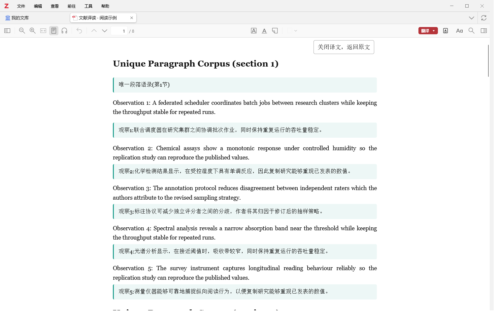
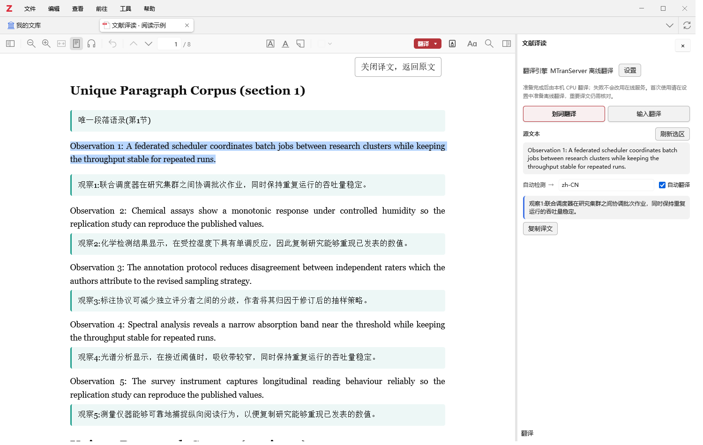
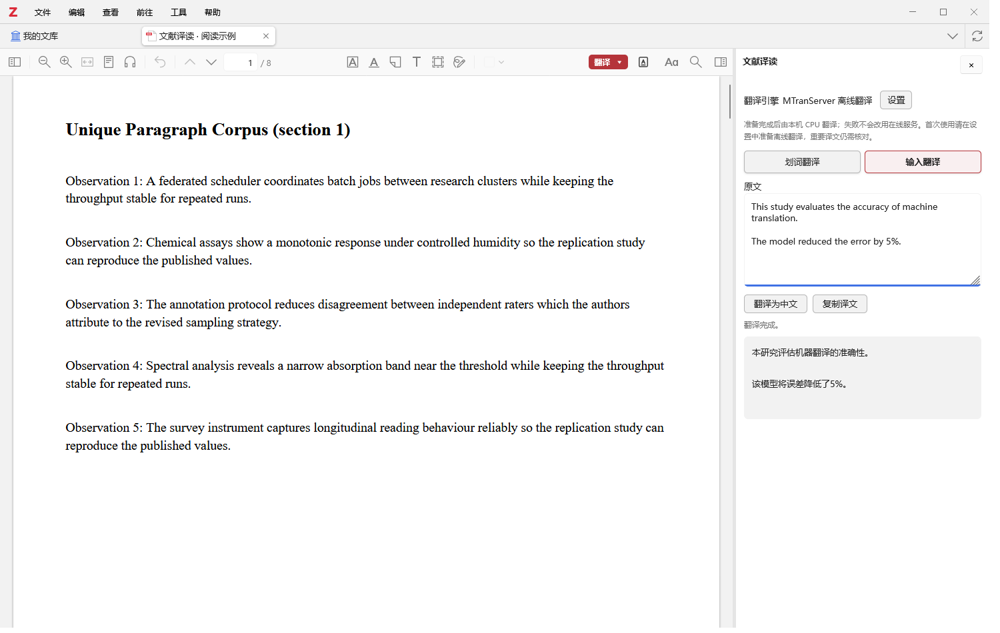
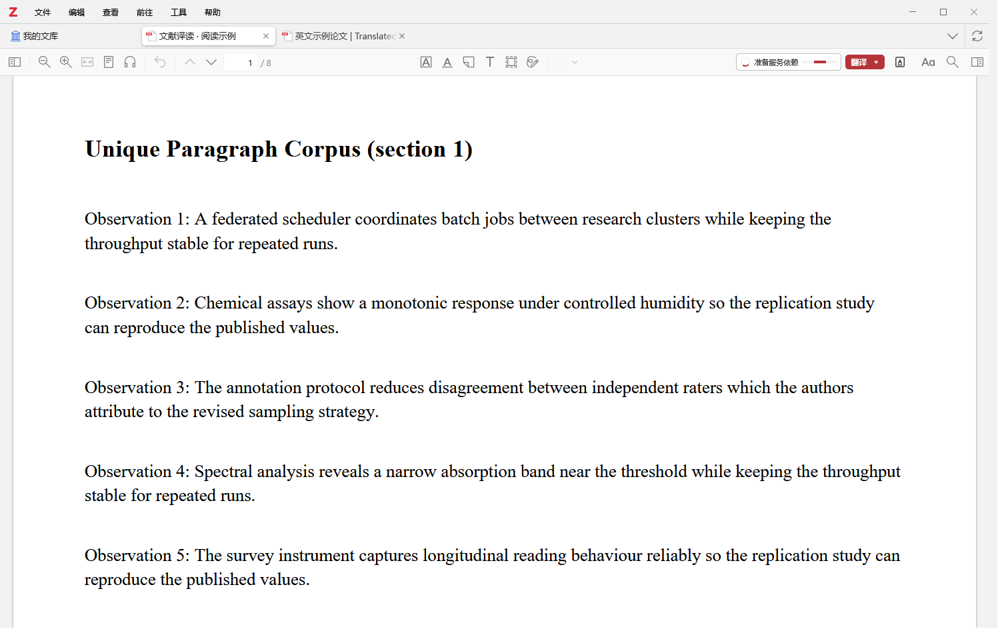

# 文献译读图文用户手册

先用四个基础功能读论文，再按需要准备离线引擎。适用环境：Windows x64、Zotero 10、可选择文字的 PDF。

[下载安装包](https://github.com/JackBlack419/wenxian-yidu/releases/latest) · [HTML 快速上手](https://jackblack419.github.io/wenxian-yidu/) · [项目首页](../README.md)

## 1. 安装与首次翻译

1. 在下载页的 **Assets** 中下载 `wenxianyidu-版本号.xpi`。`Source code` 是开发源码，不是安装包。
2. Zotero 中打开 **工具 → 插件**（部分界面叫“附加组件”），点击右上角齿轮，选择 **从文件安装插件**，选中 XPI。
3. 安装后重启 Zotero，打开 PDF，点击阅读器右上方 **翻译 ▾**。
4. 第一次会提醒选择引擎并打开设置。在下拉框选中一个服务，点击 **使用当前引擎**。可先选免密钥的必应网页翻译；自己的接口见 [接口配置](engine-setup.md)。
5. 回到论文，再次点击 **翻译 ▾**，选择下面任一方式。

**初次全文翻译**可能需要下载本地 Java 与 PDF 解析组件，按提示完成即可，不需要自己安装 Python 或配置开发环境。仅划词或输入翻译不需要这些全文组件。

## 2. 分屏翻译：左右通读全文

选择 **翻译 ▾ → 分屏翻译**。解析与翻译完成后，同一标签中左边显示原 PDF，右边显示译文。

- 拖动中间边界调整宽度；“同步阅读”勾选时联动滚动，取消后可独立阅读。
- 点击顶部 **关闭译文，返回原文**，回到普通 PDF；译文附件保留。
- 再次翻译时，完整译文可复用；部分译文优先继续补译；旧配置译文会标明配置差异。
- 分屏目前要等完整 PDF 生成后打开，暂不逐段实时显示。

## 3. 对照翻译：每段英文下面看中文

选择 **翻译 ▾ → 对照翻译**。文档进入可重排阅读视图，段落下方逐步出现译文，已完成部分可以先读。

重排会改变分页和多栏布局；核对图表、公式或原页码时，点击顶部 **关闭译文，返回原文**。对照页面也能继续选词选句，用右侧划词面板查看。

## 4. 划词翻译：随读随选

先选择 **翻译 ▾ → 划词翻译**，再选中单词、句子或一段文字，右侧面板显示原文与译文。

- 原 PDF、分屏和对照页面都支持。
- 新安装默认开启 **自动翻译**；升级保留原选择，关闭后可手动翻译。
- 切换选区会取消旧请求，防止上一段结果覆盖当前内容。
- **刷新选区** 重新读取选中内容；**复制译文** 只复制译文。
- 拖动面板左边界调宽，点击右上角 **×** 关闭，恢复阅读空间。

## 5. 输入翻译：不打开论文也能用

选择 **翻译 ▾ → 输入翻译**；在文献库中也可通过 **工具 → 文献译读：输入翻译** 打开。

输入或粘贴后点击 **翻译为中文**，完成后点击 **复制译文**。支持多段文字，可取消和重试。输入与划词共用一个侧栏，点击顶部模式按钮切换，不会新增输入标签。

## 6. 失败、取消与缓存

| 情况 | 怎么做 |
| --- | --- |
| 全文有失败段落 | 同一引擎自动补译一轮；仍失败时点击“重试失败段落（N）”，成功段落保留。 |
| 需要停下当前工作 | 从翻译菜单取消，主按钮恢复“翻译”。以后可从任务/继续入口恢复。 |
| 关闭论文后重新打开 | 结束的失败提示释放；任务和附件保留，需要时再选复用或补译。 |
| 避免重复请求 | 在设置中开启缓存，相同引擎配置、语言及规范化文本可命中已有句段。 |
| 分屏译过，对照仍请求部分内容 | 两种解析方式断句、连字符或公式表示可能不同；共用句段缓存，但不保证整篇命中或成品互换。 |

全文的分段检查点独立于通用缓存，关闭缓存不等于丢失成功段落。取消不会自动删除译文附件。

## 7. 可选：准备本机离线翻译

免费在线可直接使用；需要断网阅读时再进行这一步。

1. 保持联网，打开 **编辑 → 设置 → 文献译读**，点击 **准备离线翻译**。
2. 等待运行库、服务依赖和英中模型下载。无需安装系统 Node、Python 或 Docker。
3. 阅读器 **翻译** 左侧及设置同步显示阶段进度；点击工具栏进度可查看详情、取消或重试。
4. 下载后还需校验、解压、初始化和试译，显示 **离线翻译已就绪** 才算完成。
5. 选择 **MTranServer · 本机离线**，确认使用，返回阅读。仅选中引擎或点击翻译不会偷偷下载。

当前托管离线仅 Windows x64、英语到简体中文，使用 CPU。全文还需提前准备好 Java/解析组件。服务只监听本机，按需启动，插件退出时停止自身服务；离线失败不会自动把论文转发到在线引擎。

离线不保证比在线准确，重要术语、否定、数值和公式仍需核查。

## 8. 常见问题与其他事项

| 问题 | 处理方式 |
| --- | --- |
| 看不到入口 | 检查插件已启用并重启，再打开 PDF；本版目标为 Zotero 10。 |
| 划词没有译文 | 打开划词面板，确认自动翻译已开和引擎已确认；必要时刷新选区或测试连接。 |
| 鉴权失败 / 401 | 检查当前服务的密钥、地址与模型，不要混用其他平台的密钥。 |
| 限流或超时 | 等待后重试，或由你手动换引擎；免密钥入口不承诺持续可用。 |
| 无可提取文字 | 可能是扫描件或文字层损坏，本版不含 OCR。 |
| 公式或版面不准确 | 返回原 PDF 核对；对照不重建已损坏公式，复杂排版仍有限制。 |
| 如何更新 | 插件管理器手动检查更新，或下载新版 XPI 安装并重启；后台自动更新默认关闭。 |
| 是否收费 | 插件免费，第三方 API 额度和收费由服务商决定。 |

**隐私与反馈**：在线待译文本发给你选择的服务。API 密钥使用本机宿主安全存储；不要把密钥、私人论文或含个人信息的完整日志发到公开 Issue。提供版本、复现步骤和去除隐私的截图即可。

[接口配置](engine-setup.md) · [已知限制](known-limitations.md) · [反馈](https://github.com/JackBlack419/wenxian-yidu/issues) · [许可](../UPSTREAM.md)
